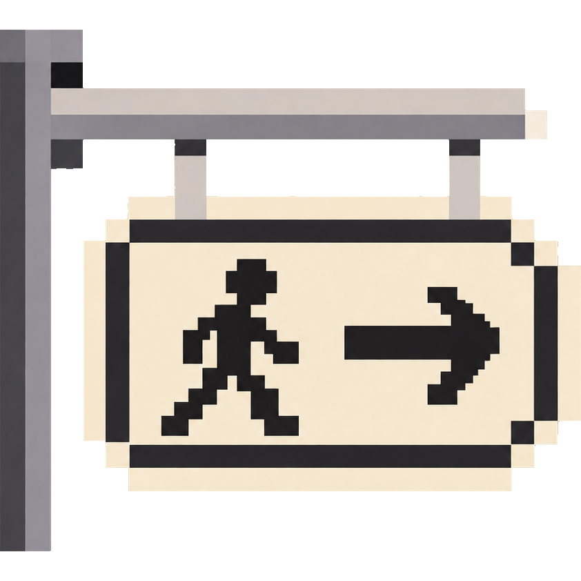
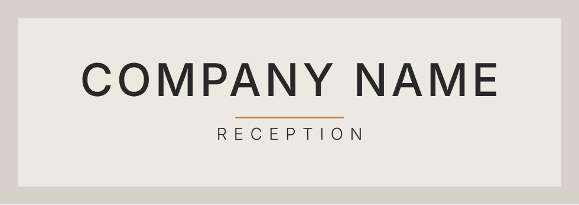
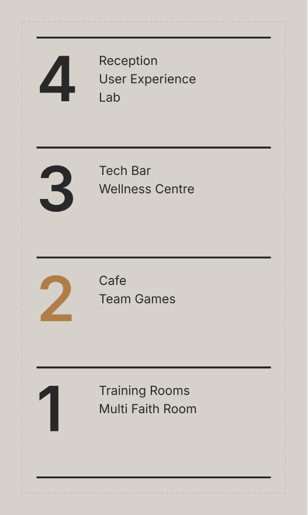
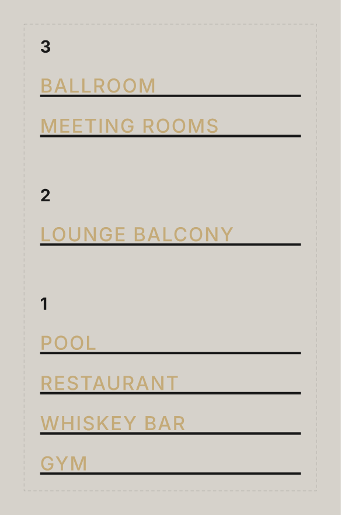
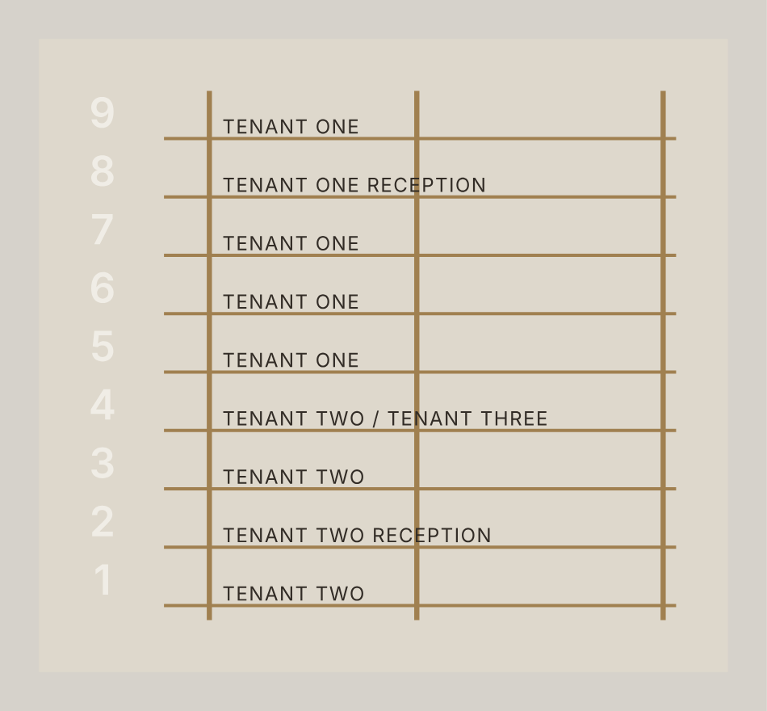
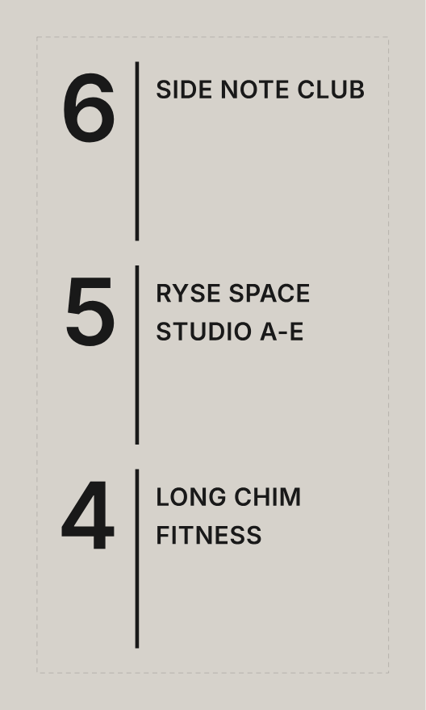

# BG Signage – Sign Designer for Revit



A Revit add-in for designing reception and wayfinding signs with InDesign-style type tools and a live preview,
then turning them into **parametric, wall-based Revit families**. It sits on the **Barr Gazetas** ribbon tab, in a
**Signage** panel, next to the other BG tools.

Works in **Revit 2024, 2025 and 2026**. New versions install from the **Updater** button without restarting Revit.

| Reception sign | Floor directory | Names on rails | Rail grid | Vertical divider |
|---|---|---|---|---|
|  |  |  |  |  |

*The built-in starting templates, laid out by the add-in's own text engine (shown here with a stand-in font).*

---

## Install (first time)

1. Open the [Releases page](../../releases) and download **BGSignage-x.y.z.zip** (not "Source code").
2. Right-click the zip → **Extract All**.
3. Double-click **Install.bat** in the extracted folder. It installs for your Windows user only, so no admin
   password is needed, and it installs for every Revit version it has a build for (2024, 2025, 2026).
4. Start Revit. If Revit asks about loading an unsigned add-in, choose **Always Load**.
5. **Barr Gazetas** tab → **Signage** panel → **Sign Designer**.

`Uninstall.bat` removes it. Files go to `%AppData%\Autodesk\Revit\Addins\<year>\BGSignage`.

## Update (no restart)

Click **Updater** on the Signage panel. It checks GitHub for a newer release and offers **Download and install**.
The next click on Sign Designer uses the new version: no need to close Revit. (It can also install a
`BGSignage-x.y.z.zip` you already downloaded, or go back to an older zip.) When a newer zip is sitting in your
Downloads folder, the button reads **Update ready**.

---

## Using the Sign Designer

The window has four areas:

- **Left – Elements and Sign.** The list of text frames, rules (bars/rails) and graphics; the family name;
  the backpanel (on/off, rectangle or ellipse, fixed size or *fit to content + padding*, corner radius);
  construction (panel thickness, letter depth, letter stand-off, rule depth, rule stand-off); the four materials
  (Panel, Letters, Accent, Rules); and how the family is hosted (**wall based** by default).
- **Middle – Preview.** Live as you type. **3D view** shows depth, stand-off and shadows. Click to select,
  **drag to move any element** (Shift = 10 mm steps, Ctrl = straight), arrow keys nudge by 1 mm (Shift = 10 mm),
  mouse wheel zooms, right-drag pans, **Fit** zooms to the sign. Under it is the **text box** for the selected frame
  (Enter = new paragraph).
- **Right – Character / Paragraph / Position**, modelled on InDesign's panels.
- **Top – toolbar**: templates, open/save `.bgsign`, undo/redo, add text / rule / graphic, duplicate, delete,
  3D view, **Export to Revit**.

### Character panel (select text first; with nothing selected a change applies to the whole line)

| Tool | What it does |
|---|---|
| Font and style | Any installed font, including OpenType **.otf** (e.g. GT America Standard) and fonts installed for your user only. **Load font file…** uses an .otf/.ttf that is not installed. |
| Size | Type size in mm; the cap height is shown underneath. |
| Leading | Baseline to baseline, or Auto (120%). |
| Kerning | Metrics (the font's own pairs) or none. |
| Tracking | Letter spacing in 1/1000 em, like InDesign. |
| V / H scale | Stretch letters vertically or horizontally. |
| Baseline shift, Skew, Rotate | Move up/down, slant (false italic), turn each letter. |
| TT, Tᴛ, T¹, T₁ | All caps, small caps, superscript, subscript. |
| Underline, strikethrough | With your own weight and offset if you want. |
| Material | Letters or **Accent** (e.g. one floor number in brass) or Rules. |

Shortcuts: Ctrl+B bold, Ctrl+I italic, Ctrl+U underline, Ctrl+Z / Ctrl+Y undo/redo, Ctrl+D duplicate, Ctrl+S save.

### Paragraph panel

Alignment (left, centre, right, justify, force-justify), left / right / first-line indents, word spacing, space
before / after, and **paragraph rules above and below** (weight, offset, width = text / frame / fixed length,
extend left/right, material). Rules below with offset 0 give the "names sitting on a rail" look.

### Position panel

Exact X / Y, frame width (Auto = no wrapping), rotation, rule length and angle (any angle, e.g. sloped
or vertical bars), graphic scale / width / mirror, and *Centre on panel* buttons. Sign coordinates are in mm from
the top-left of the backpanel; a frame's Y is the top of the capitals of its first line, so frames line up easily.

### Graphics (logos)

**+ Graphic…** imports artwork:

- **.dwg / .dxf** – read with Revit's own importer. Lines that meet are joined, so closed outlines become solids.
  Explode text to lines first; hatches are not read (draw the logo outline).
- **.ai / .pdf** – the vector shapes. Save the .ai with *Create PDF Compatible File* (Illustrator's default) and
  convert text to outlines (Type → Create Outlines). White shapes inside coloured ones become cut-outs.

Closed shapes are extruded like letters; open lines get the **Lines** width from the Position panel (0 leaves
them out). Very large or tiny drawings are scaled to about a third of the sign; change Scale or Width afterwards.

---

## The Revit family

**Export to Revit** builds `<Family name>.rfa` (in *Documents\BG Signage* unless you choose another folder),
loads it into the project and starts placing it (untick *Place after export* to only load it).

- **Wall based** (default): click a wall. Set the height with *Elevation from Level* (with the default insertion
  point this is the centre of the sign). The flip arrows put it on the other face. Face based and freestanding are
  also available.
- Category: **Signage**.
- One solid per letter, logo shape and rule, plus the backpanel, all driven by **type parameters**
  (Edit Type in Revit):

| Parameter | |
|---|---|
| `BG_Has_Backpanel` | Yes/No – lettering on a panel, or straight onto the wall. Letters move back to the wall automatically. |
| `BG_Panel_Thickness`, `BG_Panel_Material` | |
| `BG_Letter_Depth`, `BG_Letter_Standoff`, `BG_Letter_Material`, `BG_Accent_Material` | Stand-off = gap behind the letters (pins). |
| `BG_Show_Rules`, `BG_Rule_Depth`, `BG_Rule_Standoff`, `BG_Rule_Material` | |
| `BG_Sign_Text`, `BG_Sign_Width`, `BG_Sign_Height` | For schedules. |
| `BG_Sign_Data` | The design itself, so **Edit Sign** can reopen it. Don't edit by hand. |

Duplicate the type to make, for example, a brass and a black version of the same sign.

**Edit Sign** opens a placed sign in the designer, including any thickness, material or panel changes made in
Revit. Export again with the same family name to update every placed copy.

Materials: pick a project material, or type a new name (the family creates it with the swatch colour; once loaded,
a project material with the same name wins, so its render appearance is used).

---

## For developers

Requires the [.NET 8 SDK](https://dotnet.microsoft.com/download/dotnet/8.0). Visual Studio 2022 is optional.

```
dotnet build BGSignage.sln -c Release-R2024     (also Release-R2025, Release-R2026; Debug-R20xx starts Revit)
powershell -ExecutionPolicy Bypass -File installer\Install.ps1
dotnet test tests/BGSignage.Tests/BGSignage.Tests.csproj
```

| Folder | |
|---|---|
| `src/BGSignage.Core` | Sign model, text layout (InDesign-like), sign geometry, .ai/.pdf reader. No Revit or WPF: unit-tested on any OS. |
| `src/BGSignage.Engine` | Sign Designer window (WPF, built in code), Windows fonts, family builder, DWG reader. Compiles Core in, so it is one dll. |
| `src/BGSignage.Launcher` | What Revit loads at start-up: ribbon panel and Updater. Loads the newest engine per click. |
| `installer/` | Install.bat / Install.ps1 / Uninstall.bat. |
| `tools/PreviewRender` | Renders the templates to SVG on any OS (used for the pictures above). |

**Releasing:** push a tag such as `v0.2.0` (or run the *Release* workflow from the Actions tab). GitHub Actions
builds all three Revit versions and publishes `BGSignage-0.2.0.zip`, which the Updater picks up. Raise the
launcher's `<Version>` only when `src/BGSignage.Launcher` changes (that part needs a Revit restart).

**How updating without a restart works:** Revit loads only the small launcher at start-up. Each click reads
the newest `engine\<date>_v<version>` folder and loads that dll from memory (Revit 2025/2026: in its own
AssemblyLoadContext; Revit 2024: `Assembly.Load(bytes)`), so files are never locked and a new version sits
beside the old one. The engine has no XAML and no extra dlls, which keeps that safe.
